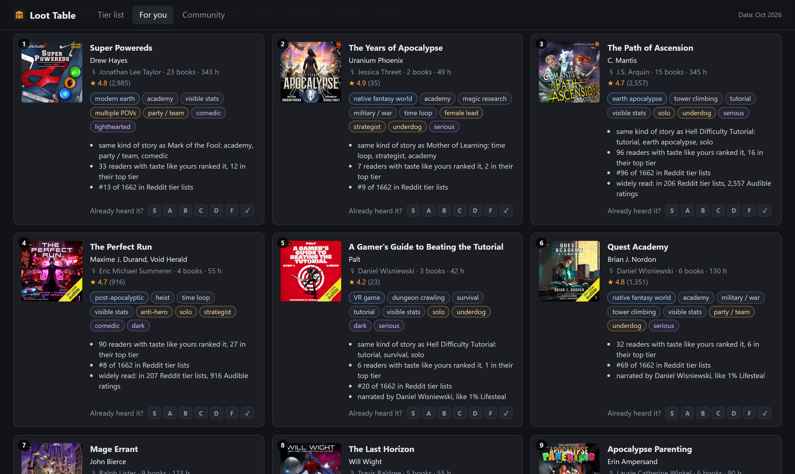
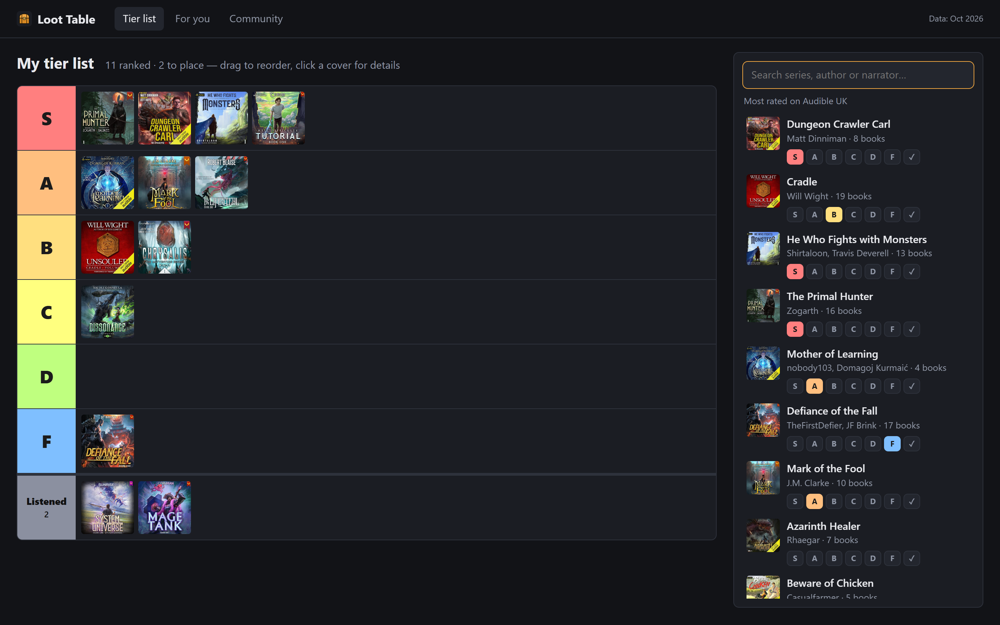

# Loot Table

**Find your next LitRPG audiobook.** Rank the series you've listened to, and Loot Table works out
what to listen to next from 900+ tier lists that readers posted on r/litrpg and
r/ProgressionFantasy, matched to what's on Audible UK.



- **Tier list**: search 3,600 series and drop them into S–F tiers.
- **For you**: picks for *your* taste, each with the reasons behind it ("same kind of story as
  Mother of Learning: time loop, academy", "28 readers with taste like yours ranked it, 11 in
  their top tier"). Filter by what kind of story you're in the mood for: cultivation, dungeon
  core, no harem, female lead…
- **Community**: the genre's top 100 by how readers rank them.
- **Share** your tier list as a link (the list is in the link itself, about 2 characters a series),
  and compare someone's shared list with yours. **Export / Import** it as a file, to move it between
  computers or from the website to the app.

Everything runs on your computer. Your tier list never leaves it: no account, no server, no
tracking.



## Install

Download the installer for your system from the [latest release](../../releases/latest):

| System | File |
|---|---|
| Windows | `Loot.Table_x.y.z_x64-setup.exe` (or the `.msi`) |
| macOS, Apple Silicon | `Loot.Table_x.y.z_aarch64.dmg` |
| macOS, Intel | `Loot.Table_x.y.z_x64.dmg` |
| Linux | `.AppImage`, `.deb` or `.rpm` |

The installers aren't signed with a paid certificate, so your system will warn you once:

- **Windows**: "Windows protected your PC" → *More info* → *Run anyway*.
- **macOS**: open it, then *System Settings → Privacy & Security → Open Anyway*.

Or skip installing and use the [website version](https://feanaroo.github.io/loot-table/): same app,
your list is kept in that browser.

## How the picks work

Five signals, added up:

1. **Community quality.** Every tier list says "X is better than Y" many times over. A
   Bradley–Terry model turns all those comparisons into one strength per series; each list
   counts the same however long it is, and a series ranked by only a couple of people is held
   near average until more lists agree.
2. **Readers with your taste.** Lists that order the series you both know the way you do
   count as your "neighbours"; what they rank high, you probably will too.
3. **Same kind of story.** Each series is tagged by setting, story, lead and tone. Series that
   share the rarer tags of your top tiers score up; ones like your bottom tiers score down.
4. **Same author or narrator** as your favourites.
5. **Popularity.** Being in hundreds of lists and having tens of thousands of ratings is a mark
   of quality too.

Mainstream fantasy (Stormlight, Harry Potter) shows up in tier lists and you can rank it, which
helps match your taste, but it's never recommended: you've heard of it.

## Data

The data was collected from public Reddit posts and the Audible UK catalog. Readers' rankings
are included without usernames. Book descriptions aren't included; each series links to its
Audible page. Covers load from Audible. Tags were written with the help of an AI model from the
series' descriptions, and some are wrong.

Loot Table isn't affiliated with Audible, Amazon or Reddit.

## Build from source

Needs [Node.js](https://nodejs.org) 22; for the desktop app also [Rust](https://rustup.rs) and the
[Tauri prerequisites](https://tauri.app/start/prerequisites/).

```sh
npm install
npm run dev          # the website version at http://localhost:5173
npm test             # checks the scoring
npx tauri dev        # the desktop app
npx tauri build      # installers for this system, in src-tauri/target/release/bundle
```

Releases: push a tag like `v0.1.0`, and GitHub Actions builds every installer into a draft
release.

## License

Code: MIT. Covers, titles and other catalog details belong to their publishers.
